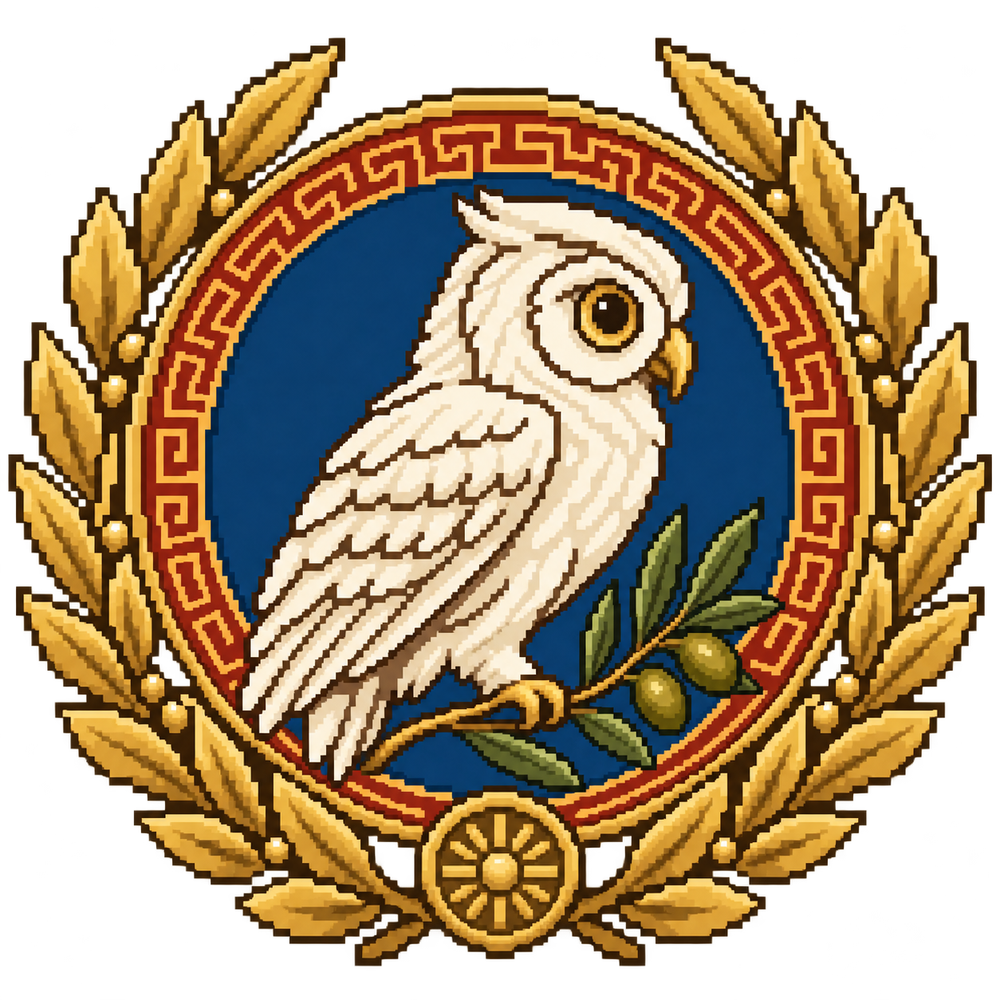

# Aletheia: Echoes of Hellas

An original co-operative top-down adventure set in a mythic Greece where the Thread of Truth has been cut. Explore sanctuaries, sea caves, labyrinths, and the agora as you solve puzzles together and confront the ideas behind each myth.

The opening tells the story in three skippable chapters. New painted artwork frames the menu and character selector. Open **Guide de l’Hellade** from the main menu to browse three hero portraits, four mythological enemies, and four illustrated scenario briefs with clear objectives. The skeleton enemy uses its original five-frame, 16-pixel sprite sheet so its scale and style match the other enemies.

## The heroes

- **Thalia**, Seeker of Aletheia — wisdom and the patient question.
- **Asteria**, Watcher of the Aegean — courage under uncertain skies.
- **Dorian**, Guardian of the Polis — justice in action.

## Campaign and artifacts

Four new scenario briefs—Delphi, Knossos, the Isles of Aeolus, and a haunted Agora—are defined in `content/hellas_campaign.json`. Core equipment is framed as the **Xiphos of Athena**, **Apollo’s Far-Sight**, **Hephaestus’ Firepot**, **Lamp of Diogenes**, and **Oracle’s Fragments**. Internal item IDs remain stable for existing maps and saves.

The four scenario briefs are narrative plans, not yet four new playable maps.

## Checks

Run `node tests/content_check.js` for the prologue, campaign, visual assets, and Greek dialogue links. With Godot 3.3.2 installed, run `godot --path . -s res://tests/smoke.gd` to check that the main scenes and new artwork load. Both checks run in the Linux build workflow.

Aletheia is built with the open source Godot Engine. Git ignores generated Godot state and build outputs while retaining source maps and assets.

## Contributing

Please open an issue to discuss a bug, question, or proposed improvement before starting substantial work. Pull requests are welcome.

## Art direction

The new art uses ivory marble, Aegean teal, indigo cloth and bronze armor. Hero colors and equipment distinguish Thalia, Asteria and Dorian. The bestiary separates the playable skeleton enemy’s Spartoi lore from planned Harpy, Talos and Minotaur encounters. These are original adaptations of Greek mythology, not claims of a single canonical telling.

Assets and generation prompts: [art manifest](ui/hellas/ART.md). Run `godot --path . -s res://tests/hellas_guide.gd` to exercise every guide page and validate the enemy animation atlas.

## Playable pixel-art environments

The sanctuary, overworld, coast and first dungeon now use a dedicated 32-tile Hellas palette: ivory marble and teal Greek-key paving, olive meadows and warm stone paths, shell-dotted sand, and terracotta Cretan mosaics. Architecture uses a separate palette per area. These changes affect the existing playable maps; exits, enemies, puzzles and collisions are preserved.

Editable art: `tiled/hellas/hellas_tiles.svg`; the adjacent PNG is its 1:1 raster export for the Tiled importer. Keep texture filtering and mipmaps disabled for this 16-pixel tileset. Run `godot --path . -s res://tests/hellas_environment.gd` to check all four maps.

Greek scenery also replaces legacy ornaments in place: Athena-inspired owl statues, Doric columns, terracotta amphorae, an oracle altar and Apollo reliefs at the sanctuary; silver-green olive trees in the overworld and along the coast; red Minoan columns in the first dungeon. `tiled/hellas/greek_props.svg` is the editable integer-grid source, with a 1:1 PNG export. Runtime texture-region replacements retain each tile’s original collision and placement.
